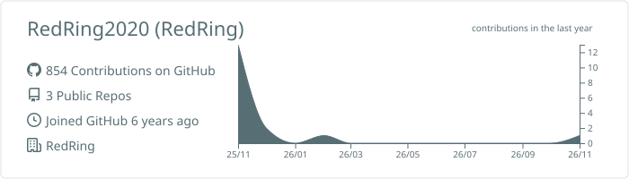
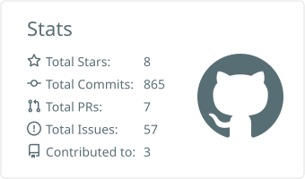
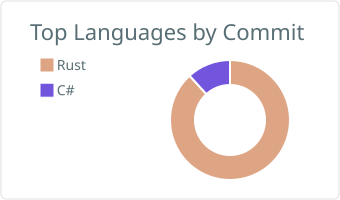

# ⭕ RedRing

**CAD/CAM kernel developer from Tokyo, building a modeling & machining platform in Rust.** 
東京を拠点に、Rust で CAD/CAM カーネルとソフトウェアを開発しています。

---

## 🔴 RedRing — Rust CAD/CAM research platform

[**RedRing2020/RedRing**](https://github.com/RedRing2020/RedRing) is a standalone CAD/CAM environment built with **Rust + wgpu**.

**v0.1.0 (preview)** — import an STL, generate a 3-axis scanline toolpath, and verify it with a cutting simulation.

| | Status |
|---|---|
| 🎨 GPU rendering (wgpu / winit) | ✅ |
| 📐 Foundation geometry & in-house NURBS curves / surfaces | ✅ |
| 🔪 3-axis scanline toolpath — ball / flat end mill, inverse offset method | 🧪 preview |
| ⚡ Cutting simulation — tri-dexel stock with animation | 🧪 preview |
| 🗂️ Machining management (operations, jobs, tool library) | 🔜 v0.2.0 |
| 🧾 Connecting moves & NC output | 🔜 v0.3.0 |
| 💾 STEP / IGES, WebAssembly, SpaceMouse | 🗺️ planned |

**Design principles:** type safety through ownership and traits · layered architecture (`foundation` → `model` → `viewmodel` → `view`) · modular crates for incremental growth.

👉 [Issues](https://github.com/RedRing2020/RedRing/issues) · [Projects](https://github.com/RedRing2020/RedRing/projects) · [Design philosophy](https://github.com/RedRing2020/RedRing/blob/develop/manual/philosophy.md) · [日本語 README](https://github.com/RedRing2020/RedRing/blob/develop/README.jp.md)

---

## 🛠️ Tech

**Main:**

**Also:**

---

## 📈 Activity

  

  
  

---

## 🌿 Elsewhere

- 🖥️ **[redring.jp](https://redring.jp/)** — project site
- 🐠 **[oriva.jp](https://oriva.jp/)** — hobby site on aquariums & paludariums (field guide, layout gallery, blog) *— coming soon*
- ✍️ [Qiita](https://qiita.com/redring) · [Stack Overflow (ja)](https://ja.stackoverflow.com/users/51688/redring) · [Reddit](https://www.reddit.com/user/RedRing2020) · [Instagram](https://www.instagram.com/redringram/) · [Facebook](https://www.facebook.com/redring2020/)

Building CAD/CAM, one crate at a time. 🦀

